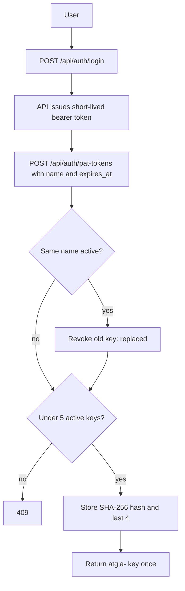

# API keys

AtGlance has two kinds of API key. This page covers personal access tokens (PATs); for service account keys see [service-accounts.md](service-accounts.md).

| Key | Prefix | Belongs to |
|---|---|---|
| Personal access token (PAT) | `atgla-` | A person |
| Service account key | `atgsa-` | A service account (machine identity) |

## Rules for personal keys (2.1.2)

- **Shown once.** A key is shown only when it is created. The console stores its SHA-256 hash and last 4 characters; there is no "View" button any more. Keys created before 2.1.2 keep working, but their stored copy was removed on upgrade.
- **Expiry is required.** 90 days by default, at most 365 days. A later date is refused (`422`). Keys created before 2.1.2 keep their old expiry (often 2099); replace them.
- **At most 5 active keys per user.** Revoked and expired keys do not count. Over the limit: `409 You have 5 active API keys. Revoke one or reuse a key name.`
- **Same name replaces.** Creating a key with the name of one of your active keys revokes the old one (reason `replaced`). A CLI that logs in again from the same host, with the same key name, never reaches the limit.
- **Revoked when you leave.** Setting a user inactive, deleting them or moving them to another organization revokes all their keys at once. Reactivating the user does not bring them back.
- **Expiry notices** 15, 7, 3, 2 and 1 days before expiry and on the expiry day: to the owner, to the organization, and to each workspace with a server registered with the key.

Admins change the limits on **Service Accounts > Settings** (`pat_default_key_days`, `pat_max_key_days`, `pat_user_quota`).

## Flow

1. The user logs in with email and password: `POST /api/auth/login` returns a short-lived bearer token (`access_token`).
2. The user calls `POST /api/auth/pat-tokens` with that bearer token, a `name` and an optional `expires_at`.
3. The API checks the rules above, stores the hash and returns the key once.
4. `GET /api/auth/pat-tokens` lists the user's keys with `last_four`, `status`, `expires_at` and `revoked_at`. It never returns the key or its hash.

To check a key and its expiry from a script or the CLI, use `GET /api/v1/whoami` or `GET /api/v1/credentials/status` ([api-reference.md](api-reference.md#cli-api-v1-apiv1)).
